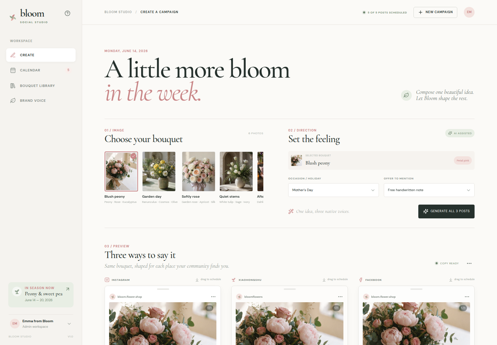

# Bloom — Social Studio

Bloom is a floral-magazine-inspired social media copywriting workspace for a flower shop. It turns one bouquet photo, one occasion, and one offer into platform-tailored content for Instagram, Xiaohongshu (RedNote), and Facebook — then lets the team drag generated posts into a weekly publishing calendar.



## What is included

- Editorial workspace with a warm ivory, blush pink, and sage green visual system.
- Six preloaded bouquet photos plus browser-based bouquet upload.
- Campaign creation from a bouquet, holiday/occasion, and offer.
- One-click generation of three platform-specific captions with a short AI-style loading state.
- Side-by-side mobile post previews for Instagram, Xiaohongshu (RedNote), and Facebook.
- Drag-and-drop scheduling into a preloaded seven-day publishing week.
- Calendar, Bouquet Library, and Brand Voice utility views.
- Responsive layout with horizontal preview rails on narrow screens.

## Quick start

Requirements: Node.js 20+, pnpm 10.18.0, and a modern browser.

```bash
pnpm install
pnpm dev:static
```

Open `http://localhost:3000` in your browser.

For a production-style static build:

```bash
pnpm build:static
```

The output is written to `dist/public`.

## Demo flow

1. Open **Create** and choose one of the bouquet photos.
2. Select an occasion, such as **Mother's Day**, and an offer, such as **Free handwritten note**.
3. Select **Generate all 3 posts** to refresh the Instagram, RedNote, and Facebook copy together.
4. Drag a platform preview down to a day in the weekly schedule strip.
5. Open **Calendar** from the left rail to see the full seven-day publishing view.
6. Open **Bouquet Library** to browse the six sample photos or add a new bouquet image.
7. Open **Brand Voice** for Bloom's writing principles and vocabulary.

See [`docs/demo.md`](docs/demo.md) for the complete demo script and acceptance notes.

For a reviewer-ready pass, use [`docs/qa-checklist.md`](docs/qa-checklist.md). The latest shipped changes are listed in [`CHANGELOG.md`](CHANGELOG.md), and contribution conventions live in [`CONTRIBUTING.md`](CONTRIBUTING.md).

## Project structure

```text
client/
  public/manus-routes.json     # Managed route manifest
  src/pages/Home.tsx            # Bloom workspace and interactions
  src/index.css                 # Floral-magazine design system
server/                         # Starter server helpers retained for future integrations
docs/
  demo.md                       # Guided product demo
  architecture.md               # UI and state architecture notes
  assets/bloom-create-demo.png  # Repository preview image
plan.md                         # Approved product and design plan
TODO.md                         # Delivered outcome checklist
CHANGELOG.md                    # Release history
CONTRIBUTING.md                 # Contributor workflow
```

## Development notes

This first release is intentionally static and local-first. Bouquet uploads use browser object URLs, sample bouquets use managed asset paths, and generated copy is represented by a short local generation state so the product can be evaluated without an external API key. The UI is structured so the copy engine and durable storage can be connected later without changing the main create flow.

The app is a Vite React frontend using the existing Webdev starter dependencies. Useful commands:

```bash
pnpm check          # TypeScript diagnostics
pnpm build:static   # Production frontend build
pnpm dev:static     # Static preview server
```

## Repository metadata

Suggested GitHub description:

> Bloom Social Studio — a floral-magazine workspace for generating and scheduling flower-shop social content across Instagram, Xiaohongshu, and Facebook.

Suggested topics: `react`, `vite`, `social-media`, `copywriting`, `content-calendar`, `flower-shop`, `rednote`, `instagram`, `design-system`.
